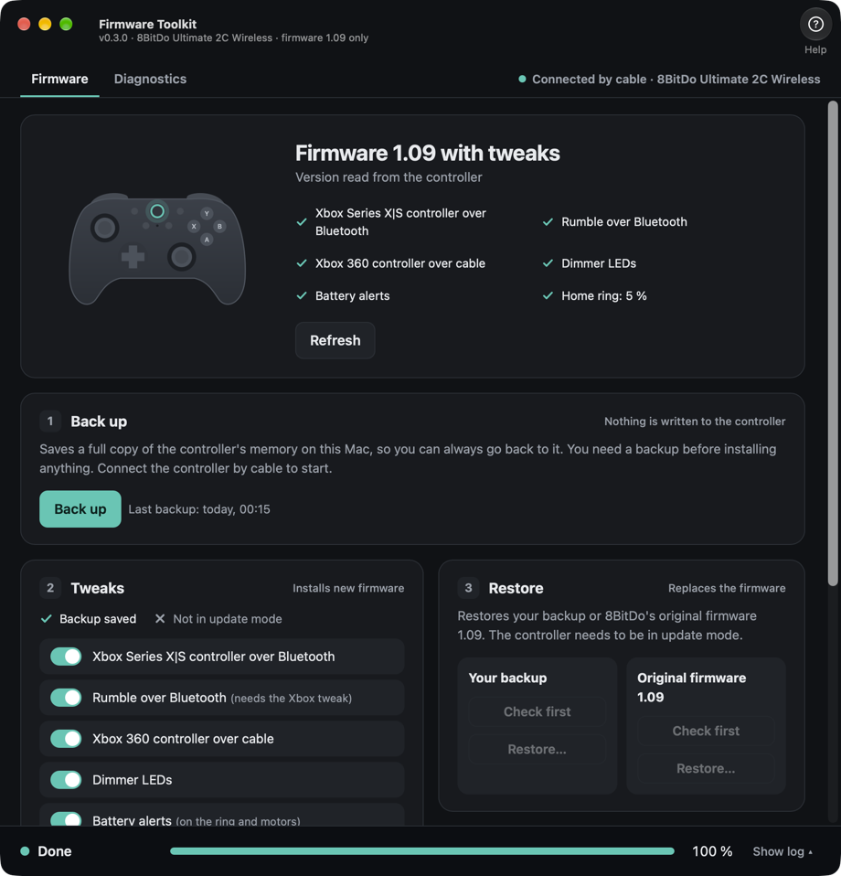
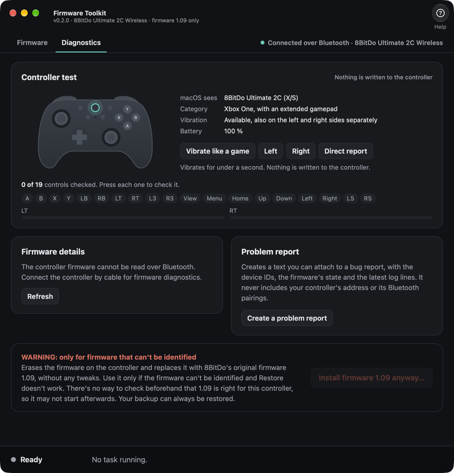

# U2C Firmware Toolkit

<p align="center">
  
  
</p>

U2C Firmware Toolkit is a toolkit for the **8BitDo Ultimate 2C Wireless** on a Mac: everything the controller needs, in one app. It makes macOS and its games treat the controller as a native one, adds rumble and control over its light, and lets you test it, back it up and restore it. There are no drivers or background programs, because the changes live in the controller itself.

## What it does

- **Works as a native controller.** Over Bluetooth it presents itself as an Xbox Series X|S controller, and by cable as an Xbox 360 controller, so macOS and its games recognise it.
- **Rumble over Bluetooth.** The original firmware doesn't vibrate over Bluetooth, and this makes it respond to games.
- **Adjustable light.** Choose how bright the ring around the Home button is, or turn it off, and change it at any time from the app or with L4 + R4 on the controller. You can also dim the other lights.
- **Battery alerts.** The ring and motors tell you when the battery is low, and when charging starts and completes.
- **Settings that change at once.** Set the sticks' dead zone, range and response, the triggers' range and the vibration from games, map L4 and R4, remap the buttons, and choose when the controller turns itself off, without installing anything each time. A guide walks you through the controller's own stick calibration.
- **Processor rest.** Over Bluetooth, the controller's processor rests between radio events instead of running without a pause, and a watchdog restarts the controller if it ever stops responding.
- **Fewer interruptions.** Playing only with the sticks no longer turns the controller off, a lost connection gets its full minute to come back, and unplugging the cable reconnects it over Bluetooth at once. Slow stick movements can also advance in finer steps.
- **Tests the controller.** See what macOS reports, including the battery, check every button, stick and trigger, and try the vibration.
- **Backs up and restores.** Save a full copy of the controller's memory first, and go back to it or to 8BitDo's original firmware at any time.

It works with the Ultimate 2C Wireless on firmware 1.09, on Macs with Apple silicon. It doesn't work with the 2.4 GHz dongle or other models.

> **This is a vibe-coded project, written with an AI assistant (Opus 5.5). There's no warranty, and you use it at your own risk.** Installing modified firmware probably voids the controller's warranty. Please read the [full disclaimer](DISCLAIMER.md) before using it. Not affiliated with or endorsed by 8BitDo.

## Install (macOS, Apple silicon)

1. Download `firmware-toolkit-<version>-macos-arm64.zip` from the releases page and unzip it.
2. Open the app once. macOS will block it because it is not signed: open **System Settings → Privacy & Security**, scroll to the message about the app and click **Open Anyway** (right-click → Open no longer works on current macOS). You can also remove it from Quarantine with xattr.
3. When asked, allow **Input Monitoring** (System Settings → Privacy & Security → Input Monitoring). The app needs it to talk to the controller.

Or with [Homebrew](https://github.com/carlosbrownef-source/homebrew-tap), which replaces step 1:

```sh
# the app
brew trust --cask carlosbrownef-source/tap/firmware-toolkit
brew install --cask carlosbrownef-source/tap/firmware-toolkit
# the command line only
brew install carlosbrownef-source/tap/firmware-toolkit
```

Or from source, with Python 3.12+: `python3 -m u2c_customfw.web` prints a local address to open in a browser; `python3 -m u2c_customfw --help` is the command line.

## Use

The app's **Help** button explains each step and why each tweak is needed.

1. **Back up** (controller connected by cable). As the flash contains not only app banks but your controller's calibration and Bluetooth pairing keys (and more), you should always keep a copy in case anything goes wrong. It is required to apply any tweaks.
2. **Tweaks**: choose tweaks, put the controller in update mode (turn it fully off, then hold LB + RB while plugging in the cable; the light will blink white), use *Check First*, then *Install Tweaks…*. Afterwards unplug the cable; if a Bluetooth tweak changed, remove the controller from Bluetooth settings and pair it again (macOS remembers the old description).
3. **Restore**: if anything looks wrong, put the controller in update mode (turn it fully off, then hold LB + RB while plugging in the cable) and restore your backup, or 8BitDo's original firmware 1.09 (downloaded from 8BitDo's update server and checked against its known SHA-256).

Safeguards, enforced in the code: the app writes nothing below `0x6000` (bootloader) or at/above `0x73000` (configuration, MAC, calibration, Bluetooth pairings), while saving a Home ring level, a mapping or the dead zone switch makes the firmware rewrite its own settings record at `0x73000`, as it does for its other settings, and saving the settings makes it write its own record at `0x7a000`, which is blank on an original controller; a write needs a backup of the same unit (the bootloader matches, and so does the MAC, allowing for the small change each new pairing makes); the firmware must be the original 1.09, with or without the tweaks; the dongle is refused, by the bootloader's identity and by how its flash reads back; a pending firmware update refuses the patch; restoring 8BitDo's v1.09 is refused unless the controller really is on 1.09 (read from its update record, or, if that is blank, identified by the hash of bank A or bank B) and is also refused when the version cannot be determined (unless you use *Install Firmware 1.09 Anyway…* in the Diagnostics tab, behind a warning and a confirmation that spells out the risks; it never overrides a version that is known to be different); every edit checks the stock bytes it replaces.

## Settings

The Settings tab changes the controller while it's connected by cable, once the Controller settings tweak is installed. A change applies at once and is lost when the controller turns off or restarts, unless you press *Save to Controller*. *Reset to Defaults…* puts these settings back, apart from the Home ring and the calibration, and works without pressing any buttons on the controller. Restoring the firmware doesn't erase them: the original firmware ignores most of them, and they apply again if you install the tweak again, but it keeps using the L4 and R4 mappings and the dead zone switch, because those are its own. Use *Reset to Defaults…* first if you want those gone.

- **Sticks:** the dead zone (14 % at first), where a stick reaches full movement, its response, and inverting either axis. Holding − (Select) and + (Start) together for about 4 seconds turns the dead zones off and on from the controller.
- **Triggers:** where each one starts to count and where it reaches full.
- **L4 and R4:** what each one presses, including the triggers. Pressing L4 and R4 together changes the Home ring's brightness, and games also receive the buttons you mapped to them. Over Bluetooth, games don't see L4 and R4 at all unless you map them.
- **Vibration:** how strongly games make the controller vibrate. Battery alerts keep their own strength.
- **Power:** how long it stays on, connected, with nobody using it, and whether it vibrates on connecting.
- **Button remapping:** what each button does, or nothing. Home and the triggers can't be changed.
- **Calibration:** a guide to the controller's own stick calibration. The app doesn't send it anything.
- **Home ring:** its brightness, applied at once and kept with Save Ring Level. This also works over Bluetooth, with Rumble over Bluetooth installed.

With every setting at its default, the sticks, triggers and buttons run the firmware's original code. The live view is only available in the Mac app; the settings work anyway.

## Diagnostics

The Diagnostics tab helps you check how macOS sees the controller after installing tweaks, and gather information if something goes wrong.

- **Controller test:** shows what macOS's GameController reports, which is what a game gets, including the battery when macOS provides it. Press each button, stick and trigger to see it light up, and make the controller vibrate either the way a native game would or by sending the report straight to the controller. If only the direct report vibrates, the firmware isn't the problem.
- **Firmware details:** what the app read from the controller, including where the version came from, whether a firmware update is pending, and how the bootloader identifies itself.
- **Problem report:** a text you can attach to a bug report.
- **Install Firmware 1.09 Anyway…:** the last resort for a controller whose firmware can't be identified.

The controller test is only available in the Mac app for now, because it uses macOS's GameController directly. Everything else in the tab also works when you run the app from source.

## What the tweaks do

| Tweak | Effect |
| --- | --- |
| Xbox Series X\|S controller over Bluetooth | Over Bluetooth the controller presents as an Xbox Series X\|S pad (`045e:0b13`), so macOS's GameController framework handles it natively (name "8BitDo Ultimate 2C (X/S)"). Needs a re-pair afterwards (or macOS may still detect it as a HID device). |
| Rumble over Bluetooth | Rumble works over Bluetooth (the original firmware switches the motors off in that mode). Needs the Xbox tweak as it uses its profile. In rare cases it could make the controller stop responding. This hasn't been observed. |
| Xbox 360 controller over cable | Plugged in by cable it presents as a wired Xbox 360 pad (`045e:028e`), which Apple's own driver takes. It changes the least code of all the tweaks. |
| Dimmer LEDs | Slightly lowers the brightness of the controller's three lights, by giving them weak drive strength. It is subtle: to really change the ring around the Home button, use Home Ring in the Settings tab. |
| Battery alerts | The ring blinks slowly while charging and quickly at 15 % or less, even if you turned it off. The motors give one short pulse when charging starts, one long pulse when it completes, and two short pulses at 5 % or less, again every 5 minutes. Needs the Home ring's code. |
| Controller settings | Adds what the Settings tab changes. Needs the Home ring's code. |
| Fixes | Moving a stick counts as using the controller, which the original firmware only notices through buttons, so playing only with sticks no longer turns it off after 15 minutes. A dropped connection gets its full search time. Unplugging the cable in the Bluetooth position restarts the controller, so it finds the Mac at once. It also closes the firmware update over Bluetooth, which needs no encryption. Needs the Home ring's code. |
| Processor rest | Over Bluetooth on battery, the original firmware keeps the processor busy in a loop. This stops it for up to 1 ms at a time between radio events, woken by the radio, the system timer or its own 1 ms timer. A watchdog restarts the controller if the main loop ever stops for 3 s. On by default. Needs the Home ring's code. |
| Finer stick movement | The firmware ignores stick changes of up to 20 of about 4,000 steps, which makes slow movement advance in small jumps. This lowers that threshold to 14, just above the noise measured on one controller, and reads the sticks twice per report. A stick held still away from the centre may still move by one step now and then. Off by default. Needs the Home ring's code. |
| Faster button reading | The firmware reads the buttons and triggers every 5 ms. This reads them every 2.5 ms, so a press arrives about 1.25 ms sooner on average. The time Home must be held and turbo's rate are rescaled to stay the same. About 100 fast taps on one controller showed no double presses, but the firmware has no other debounce, so a worn button could bounce. Off by default. |
| Home ring | The code that drives the ring around the Home button, installed with any tweak that needs it. Its level is set in the Settings tab or with L4 + R4: normal, 25 %, 5 %, 1 %, 0.1 % or off (the percentage is PWM duty, not perceived brightness). It still blinks while searching or pairing, at its usual brightness, and settles at your level once connected. Installing keeps the ring's level as it is. |

Each tweak is a hash-checked set of byte edits to the stock v1.09 image; nothing else in the firmware changes, and the controller's bootloader, MAC, calibration and pairings are never written.

## Why this is public

Out of the box, macOS and most Mac games don't recognise the Ultimate 2C as a standard controller (just as a HID device). This project is
public to help Mac users use it as a native controller on their system. This doesn't happen on Windows, as it isn't as inflexible as macOS in detecting Xbox 360-compatible controllers (when using a cable), and because it supports Xbox 360 controllers via bluetooth, and macOS does not.

It only supports this controller with firmware 1.09, because that is the only one I have and could test. The same
approach could probably be extended to other firmware versions, and perhaps to other 8BitDo controllers, but I can't do that
myself without the hardware. If you have one, [docs/firmware-notes.md](docs/firmware-notes.md) explains how the
firmware is laid out and [docs/porting.md](docs/porting.md) how to port the app to Linux. It would only work if the firmware is not encrypted.

This is possible because the controller's firmware is neither encrypted nor signed: 8BitDo's update file is a plain
image, and the controller's bootloader only checks a CRC on each block it receives, so it accepts and runs a modified
firmware. Each tweak here is a small, hash-checked edit to that image.

## Porting to Linux

The only OS-specific part is `u2c_customfw/transport/`. See [docs/porting.md](docs/porting.md).

## Documentation

- [docs/firmware-notes.md](docs/firmware-notes.md): flash layout, update and bootloader protocols, RAM code.
- [docs/bluetooth-and-rumble.md](docs/bluetooth-and-rumble.md): how the Bluetooth Xbox identity and rumble work.
- [firmware-src/README.md](firmware-src/README.md): the C and assembly we add, and how to rebuild it.
- [docs/releasing.md](docs/releasing.md): publishing a new version, and how the Homebrew tap follows it.

## Other projects

Other people reached the same goal on their own, and these are worth a look:

- **[vomba/8bitdo-ultimate-2c-apple](https://github.com/vomba/8bitdo-ultimate-2c-apple)** changes just six bytes of firmware 1.09 so Apple uses its SN30 Pro+ profile: the smallest possible patch, without rumble. Its owner reports that it also works on Apple TV.
- **[Crazyawk/8bitdo-ultimate2c-macos-rumble](https://github.com/Crazyawk/8bitdo-ultimate2c-macos-rumble)** brings Bluetooth rumble to CrossOver games, with patched firmware and an SDL shim.
- **[lodo4nik/8bitdo-sdl-macos-fix](https://github.com/lodo4nik/8bitdo-sdl-macos-fix)** helps SDL games and CrossOver recognise the controller on macOS without touching its firmware, by changing one setting each time you log in.
- **[amirreza225/8bitdo-ultimate-2c-mac](https://github.com/amirreza225/8bitdo-ultimate-2c-mac)** makes the Ultimate 2C **Wired** work in Chrome and Amazon Luna, with a browser extension. This app doesn't support that model.

## Credits

- **[jgus-org/8bitdo-2c-re-flake](https://github.com/jgus-org/8bitdo-2c-re-flake)** (MIT): reverse engineering of the
  Ultimate 2C's update and bootloader protocols, its recovery and its flash layout. It was the base for firmware analysis, and allowed me to obtain the official update files. No code was copied, the protocols were reimplemented based on jgus's notes.
- **[xpadneo](https://github.com/atar-axis/xpadneo)**: the captured Xbox Series X|S Bluetooth report descriptor, used to rewrite the HID report to match the newer protocol.
- **[supercypok/ultimate2c-ring](https://github.com/supercypok/ultimate2c-ring)** (MIT): how to drive the Home ring with PWM (registers, the LED task's call for the ring, its startup state) and the idea of keeping it dim while the controller runs. The Home ring tweak here is my own reimplementation of that method, placed differently and keeping the blink while pairing.
- **[Crazyawk/8bitdo-ultimate2c-macos-rumble](https://github.com/Crazyawk/8bitdo-ultimate2c-macos-rumble)** (MIT): the earliest public use I found of the bootloader's identity query, used here as an extra check that the device in update mode is the controller, and the idea of testing vibration both through CoreHaptics and directly.
- **[vomba/8bitdo-ultimate-2c-apple](https://github.com/vomba/8bitdo-ultimate-2c-apple)** (MIT): notes on that query and on the update record's pending-update fields, checked here before patching.
- **[MoridaDE/8bitdo-2c-battery-tray](https://github.com/MoridaDE/8bitdo-2c-battery-tray)** (MIT): the idea of showing the battery, and notes on where it can be read.
- **8BitDo**: the hardware, and the update server the app downloads firmware 1.09 from (only on request).
- **Telink**: the tc32 toolchain ([flyskywhy/tc32](https://github.com/flyskywhy/tc32)) used to build `firmware-src/`.

## License

GPL-3.0-or-later; see `LICENSE`. Credits are [above](#credits) and in [CREDITS.md](CREDITS.md). 8BitDo firmware is not included in this repository. Not affiliated with or endorsed by 8BitDo. The command-line tool is called `u2c-customfw`.
