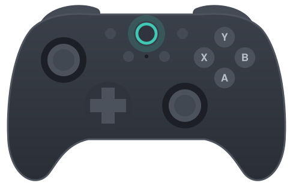

# u2c-customfw

Back up, patch and repair the firmware of the **8BitDo Ultimate 2C Wireless controller (firmware 1.09)**, so macOS treats it as an Xbox controller and every game sees it.

> ## READ THIS FIRST
> **This is a vibe-coded project.** It was written with an AI assistant and tested on a single controller.
>
> **It comes with NO WARRANTY of any kind, explicit or implied**, including any warranty of merchantability or fitness
> for a particular purpose. You use it entirely at your own risk.
>
> **By using this app you lose your controller's warranty.** Writing a modified firmware to the controller voids it.
>
> **It only works with the 8BitDo Ultimate 2C Wireless controller running firmware 1.09.** It does not work with the
> 2.4 GHz dongle, with other 8BitDo models, or with other firmware versions, and it refuses them.
>
> **It will probably break compatibility with 8BitDo's own apps**, both the Firmware Updater and Ultimate Software.
>
> **You can always return to the original firmware.** The part of the controller that runs update mode (its bootloader)
> is never modified, and Restore restores either your own backup or 8BitDo's firmware 1.09.

## Why this is public

Out of the box, macOS and most Mac games don't recognise the Ultimate 2C as a standard controller. This project is
public to help Mac users use it as a native controller on their system.

It only supports this controller with firmware 1.09, because that is the only one I have and could test. The same
approach could be extended to other firmware versions, and perhaps to other 8BitDo controllers, but I can't do that
myself without the hardware. If you have one, [docs/firmware-notes.md](docs/firmware-notes.md) explains how the
firmware is laid out and [docs/porting.md](docs/porting.md) how to port the app to Linux.

This is possible because the controller's firmware is neither encrypted nor signed: 8BitDo's update file is a plain
image, and the controller's bootloader only checks a CRC on each block it receives, so it accepts and runs a modified
firmware. Each tweak here is a small, hash-checked edit to that image.

## Credits

- **[jgus-org/8bitdo-2c-re-flake](https://github.com/jgus-org/8bitdo-2c-re-flake)** (MIT): reverse engineering of the
  Ultimate 2C's update and bootloader protocols, its recovery and its flash layout. This project reimplements those
  protocols from jgus's notes; it does not copy its code.
- **[xpadneo](https://github.com/atar-axis/xpadneo)**: the captured Xbox Series X|S Bluetooth report descriptor.
- **8BitDo**: the hardware, and the update server the app downloads firmware 1.09 from (only on request).
- **Telink**: the tc32 toolchain ([flyskywhy/tc32](https://github.com/flyskywhy/tc32)) used to build `firmware-src/`.

## What the tweaks do

| Tweak | Effect |
| --- | --- |
| Xbox Series X\|S controller over Bluetooth | Over Bluetooth the controller presents as an Xbox Series X\|S pad (`045e:0b13`), so macOS's GameController framework handles it natively (name "8BitDo Ultimate 2C (One)"). Needs a re-pair afterwards. |
| Rumble over Bluetooth | Rumble works over Bluetooth (the original firmware switches the motors off in that mode). Needs the Xbox tweak. |
| Xbox 360 controller over cable | Plugged in by cable it presents as a wired Xbox 360 pad (`045e:028e`), which Apple's own driver takes. |
| Dimmer LEDs | The three LEDs use weak drive strength: a little dimmer. |

Each tweak is a hash-checked set of byte edits to the stock v1.09 image; nothing else in the firmware changes, and the controller's bootloader, MAC, calibration and pairings are never written.

## Install (macOS, Apple silicon)

1. Download `u2c-customfw-<version>-macos-arm64.zip` from the releases page and unzip it.
2. Open the app once. macOS will block it because it is not signed: open **System Settings → Privacy & Security**, scroll to the message about u2c-customfw and click **Open Anyway** (right-click → Open no longer works on current macOS).
3. When asked, allow **Input Monitoring** (System Settings → Privacy & Security → Input Monitoring). The app needs it to talk to the controller.

Or from source, with Python 3.12+: `python3 -m u2c_customfw.web` prints a local address to open in a browser; `python3 -m u2c_customfw --help` is the command line.

## Use

The app's **Help** button explains each step and why each tweak is needed.

1. **Back up** (controller connected by cable). Required before the first change; keep the file.
2. **Tweaks**: choose tweaks, put the controller in update mode (turn it fully off, then hold L1 + R1 while plugging in the cable; the light will blink white), use *Check first*, then *Install tweaks*. Afterwards unplug the cable; if a Bluetooth tweak changed, remove the controller from Bluetooth settings and pair it again (macOS remembers the old description).
3. **Restore**: if anything looks wrong, put the controller in update mode and restore your backup, or 8BitDo's original firmware 1.09 (downloaded from 8BitDo's update server and checked against its known SHA-256).

Safeguards, enforced in the code: nothing is written below `0x6000` (bootloader) or at/above `0x73000` (configuration, MAC, calibration, Bluetooth pairings); a write needs a backup of the same unit (bootloader and MAC match); the firmware must be the original 1.09, with or without the tweaks; the dongle is refused; restoring 8BitDo's v1.09 is refused unless the controller really is on 1.09 (read from its update record, or, if that is blank, identified by the hash of bank A or bank B) and is also refused when the version cannot be determined (unless you use *Install firmware 1.09 anyway* under Restore, behind a warning and a confirmation that spells out the risks; it never overrides a version that is known to be different); every edit checks the stock bytes it replaces.

## Porting to Linux

The only OS-specific part is `u2c_customfw/transport/`. See [docs/porting.md](docs/porting.md).

## Documentation

- [docs/firmware-notes.md](docs/firmware-notes.md): flash layout, update and bootloader protocols, RAM code.
- [docs/bluetooth-and-rumble.md](docs/bluetooth-and-rumble.md): how the Bluetooth Xbox identity and rumble work.
- [firmware-src/README.md](firmware-src/README.md): the C and assembly we add, and how to rebuild it.

## License

GPL-3.0-or-later; see `LICENSE`. Credits are [above](#credits) and in [CREDITS.md](CREDITS.md). 8BitDo firmware is not included in this repository.
